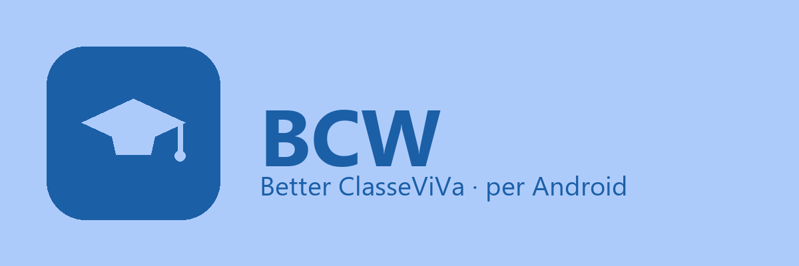
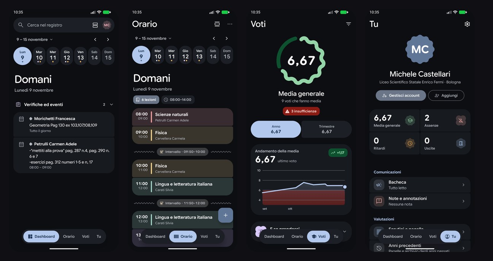

<p align="center">
  
</p>

<h1 align="center">BCW per Android</h1>

<p align="center">
  <strong>Il registro elettronico Classeviva, ridisegnato.</strong><br/>
  Material 3 Expressive, widget vivi, lezione in corso nella barra di stato — e la tua scuola, bella da guardare.
</p>

<p align="center">
  <a href="https://github.com/kubos5/BCW">📱 Versione iPhone e iPad</a> ·
  <a href="https://github.com/kubos5/BCW-web">🌐 Versione web</a> ·
  <a href="https://github.com/kubos5/BCW-api">☁️ Account BCW</a>
</p>

<p align="center">
  
</p>

---

> **BCW** significa *Better ClasseViVa*: tutte le funzioni del client ufficiale di [Classeviva](https://web.spaggiari.eu) (Gruppo Spaggiari Parma), più quelle che ti sarebbero utili davvero — obiettivo di media, compiti da spuntare, orario che si disegna da solo. Questa è la versione **Android**, nativa, con lo stesso account della versione per iPhone e quella web.
>
> *BCW non è affiliato a Gruppo Spaggiari Parma S.p.A.*

## Perché BCW

Classeviva è il registro che usi ogni giorno: qui è rifatto da capo, con attenzione alle cose che contano.

- **Media che si capisce** — calcolata come vuoi (tutti i voti o le medie, con o senza pesi), con l'effetto di ogni voto, grafici dell'andamento, obiettivo da raggiungere e *"E se prendessi…"* per sapere prima della prova quanto ti serve.
- **Orario vero** — la settimana compilata a mano o generata dalle lezioni registrate, con intervalli, colori, note e file per ogni giorno, verifiche di Classeviva che compaiono da sole e una modalità di modifica con trascinamento e allineamento.
- **Tutto in una ricerca** — compiti, voti, comunicazioni, materiale e note, dalla barra in cima alla Dashboard.
- **Più account, una sola app** — anche genitore con più figli; si cambia tenendo premuta la scheda Tu. Con un [account BCW](https://github.com/kubos5/BCW-api) impostazioni, aspetto e orario ti seguono su telefono, iPhone e web.
- **Offline** — l'ultimo aggiornamento resta consultabile senza rete.
- **Demo** — dati di esempio per provare l'app senza account.

## Android in più

Le parti di sistema sono equivalenti Android di quelle di iOS, con lo stesso carattere (Google Sans Flex) e gli stessi colori:

| | |
|---|---|
| 📊 **Lezione in corso** | una notifica che si aggiorna da sola (Live Updates su Android 16) nella barra di stato e nella schermata di blocco: materia, aula, quanto manca, la lezione dopo |
| 🧩 **Widget** | Orario, Lezione in corso, Compiti e verifiche, Prossima verifica, Media (con la media ingrandita: anello e ultimi voti) — nei colori del tema, che si aprono nel punto giusto |
| 🔔 **Notifiche** | promemoria la sera prima di compiti e verifiche, novità (voti, comunicazioni, note, assenze) controllate ogni ora circa |
| 🔒 **Blocco** | impronta, volto o blocco schermo del telefono |
| 📅 **Calendario** | compiti, verifiche ed eventi nel calendario del telefono |
| 🎨 **Aspetto** | colore d'accento (o Material You), contrasto, angoli, animazioni |

## Installazione

Finché l'app non arriva su Google Play, puoi compilarla:

1. installa [Android Studio](https://developer.android.com/studio) (o solo l'SDK, piattaforma 36)
2. clona e apri:

   ```bash
   git clone https://github.com/kubos5/BCW-android
   ```

3. esegui su un telefono collegato (debug USB) o su un emulatore

Da riga di comando:

```bash
./gradlew :app:assembleDebug
```

L'APK di debug è in `app/build/outputs/apk/debug/` (identificativo `com.bcw.classeviva.debug`, va accanto alla release).

**Requisiti:** Android 8.0 (API 26) o più; Live Updates da Android 16; per compilare JDK 17 e SDK 36.

### Prove

```bash
./gradlew :app:testDebugUnitTest
```

Confrontano demo, orario e colori del tema con la versione web, e avviano l'app vera con Robolectric salvando gli screenshot in `app/build/screenshots`.

---

## Mantieni il passo con il progetto principale

BCW-android dipende da [**kubos5/BCW**](https://github.com/kubos5/BCW), il progetto principale per iPhone e iPad: le funzioni nascono lì e qui vengono portate su Android. Per aggiornare questa versione con agenti AI (Claude Code, Codex, o l'agente che preferisci), usa questo prompt:

```text
Aggiorna BCW-android con le ultime novità della repo principale kubos5/BCW.

1. Guarda cosa c'è di nuovo in kubos5/BCW (gh api repos/kubos5/BCW/commits):
   - leggi gli ultimi commit e i file che toccano (gh api repos/kubos5/BCW/commits/<sha>)
   - concentrati su Features/ e Store/: sono le funzioni visibili e i dati che le alimentano
   - il README di kubos5/BCW descrive ogni funzione in italiano: è la specifica a cui tendere

2. Per ogni novità che ha senso su Android (salta Liquid Glass, Dynamic Island e
   le altre cose proprie di iOS):
   - leggi come funziona nella repo principale e come l'app Android risolve oggi la
     stessa cosa (cerca in app/src/main/java/com/bcw/classeviva/ la parte corrispondente)
   - portala su Android con gli strumenti di questa repo: Compose e Material 3
     Expressive in ui/ (Design e Components sono l'equivalente di Design/ e
     Components/ dell'app iOS), i dati in data/, le parti di sistema in platform/
   - rispetto i criteri dell'app: transizioni di Material 3 (asse condiviso,
     dissolvenza), colori del tema, animazioni ridotte per chi le disattiva,
     testi in italiano

3. Fai funzionare tutto:
   - compila: ./gradlew :app:compileDebugKotlin
   - prova: ./gradlew :app:testDebugUnitTest
   - installa e guarda: ./gradlew :app:installDebug poi avvia l'app su emulatore
     o telefono, e verifica le schermate toccate dalla novità
   - aggiorna il README se la novità cambia una funzione elencata

4. Apri una pull request verso main con un titolo e una descrizione in italiano,
   una funzione per PR, dicendo cosa hai portato dalla repo principale e come l'hai
   adattata ad Android.
```

## Licenza

Distribuita con licenza MIT. Vedi [LICENSE](LICENSE).

---

<a href="https://star-history.com/#kubos5/BCW-android&Timeline">
 <picture>
   <source media="(prefers-color-scheme: dark)" srcset="https://api.star-history.com/svg?repos=kubos5/BCW-android&type=Timeline&theme=dark" />
   <source media="(prefers-color-scheme: light)" srcset="https://api.star-history.com/svg?repos=kubos5/BCW-android&type=Timeline" />
   
 </picture>
</a>
